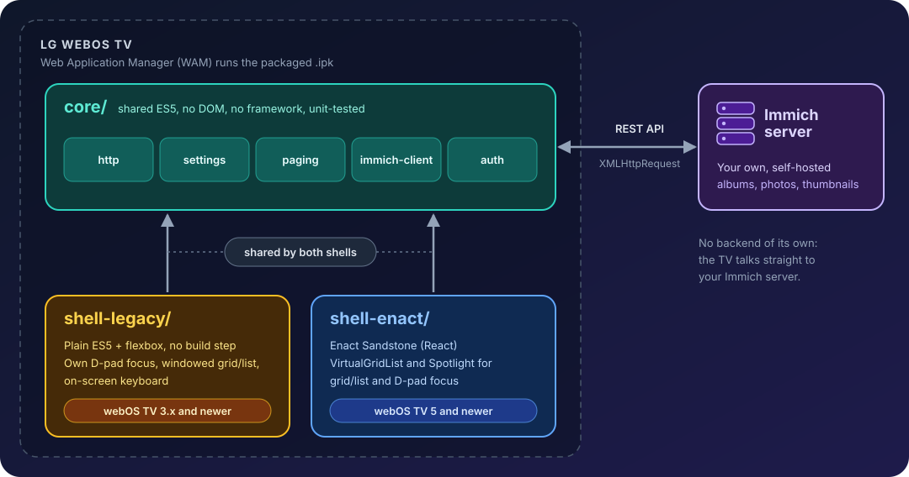

# Immich for webOS TV

Browse your [Immich](https://immich.app) albums and photos on an LG TV with the remote only.

The idea of this app is quite simple. A wrapper, that connects to a remote Immich isntance and loads album and assets to display on the TV.

The first version is meant to just list albums and show pictures full screen. No local cache for the assets, no meaningful settings except for the dispaly layout. It can display them as a grid or a list, with 3 to 8 columns per row.

Later on, I plan to implement video support, assets cache, search, map, people/faces and some more settings.

It runs on LG TVs from webOS TV 3.x (2016-17 models) up to current ones. 
For that, there are two different builds.

## Why it exists

A TV is where a photo library is most pleasant to look at. While there is an app available for [AndroidTV](https://github.com/giejay/Immich-Android-TV), there is none for WebOS.

The aim is to:

- **Remote-only navigation.** Every screen works with the D-pad. Long lists are windowed so a library of tens of thousands of photos stays smooth on a weak TV processor.
- **Typing is the hard part.** Signing in needs a server address and an API key, both long strings. The app ships its own on-screen D-pad keyboard with shortcut keys (`https://`, `.com`, `:2283`), remembers previous server addresses, and can hand over to the TV's own keyboard.
- **Old TVs must keep working.** Many people (Guess if I am included) own a 2016-17 LG TV. webOS TV 3.x runs Chromium 38, which has no `fetch`, no CSS grid and no modern JavaScript, and LG does not support the Enact framework there. So the core of the app is written in plain ES5.

## Required API Permissions

Like for Immich for Andorid OS, your Immich API key needs some particular permissions. Make sure to set them.
This is pretty much the same permission that the AndroidTV app requires too.

* `activity.read` - Read activity data
* `album.download` - Download album content
* `album.read` - Read album information
* `archive.read` - Read archived items
* `asset.download` - Download assets for viewing
* `asset.read` - Read asset metadata
* `asset.view` - View assets (photos/videos)
* `face.read` - Read face detection data
* `folder.read` - Read folder information
* `library.read` - Read library information
* `memory.read` - Read memory/moment data
* `partner.read` - Read partner sharing data
* `person.read` - Read person/people data
* `session.read` - Read session information
* `tag.asset` - Read asset tag associations
* `tag.read` - Read tag information
* `timeline.read` - Read timeline data

## Architecture

The app is a static web app packaged as an `.ipk` and run by the TV's Web Application Manager (WAM), the standard webOS web-app model. It has no server component of its own: the TV talks directly to your Immich server over its REST API.

**`core/`** holds everything that talks to Immich or keeps state. It has no DOM and no framework, so both shells use it unchanged and it is unit-tested with `node --test`:

| Module | Responsibility |
|---|---|
| `http` | `XMLHttpRequest` wrapper returning Promises (there is no `fetch` on webOS 3.x); timeouts and classified errors (`network`, `timeout`, `unauthorized`, `http`) |
| `settings` | server address, API key, view mode, columns per row, photo size, remembered server addresses (stored in `localStorage`) |
| `paging` | loads "All photos" page by page so a whole library is never fetched at once |
| `immich-client` | albums, album contents, paged photo search, thumbnail and preview URLs; only photos are returned |
| `auth` | validates the server address and API key against Immich, and saves them only after a successful check |

**The shells** are thin UIs on top of the core, with the same screens: Setup, Albums, Album, Photo viewer, Settings.

- `shell-legacy/` is hand-written ES5 with flexbox and no build step. It brings its own D-pad focus handling, a windowed grid/list, and the on-screen keyboard. It is the only build that can run on webOS TV 3.x and 4.x.
- `shell-enact/` uses the [Enact](https://enactjs.com/) framework (Sandstone theme) for webOS 5 and newer, following LG's recommended stack. LG documents Enact as supported from webOS TV 4.0 and Sandstone from 5.0.

`core/` and `shell-legacy/` are checked automatically: `npm test` runs ESLint set to ES5 plus a gate that rejects APIs missing on Chromium 38. The LG Simulator has no webOS 3.x image, so this gate is what keeps the legacy build honest between real-TV tests. The design decisions are recorded in [docs/superpowers/specs/](docs/superpowers/specs/) and the implementation plan in [docs/superpowers/plans/](docs/superpowers/plans/).

## Builds

| Build | App id | Runs on | Engine |
|---|---|---|---|
| Legacy (plain ES5) | `com.immich.webos` | webOS TV 3.x and newer | Chromium 38+ |
| Enact Sandstone | `com.immich.webos.enact` | webOS TV 5 and newer | Chromium 68+ |

Both builds share `core/` (Immich client, settings, auth). If your TV is a 2016-2019 model, use the legacy build; on webOS 5 or newer either works.

How each package is produced (the installable `.ipk` files land in `build/`):

| Build | Command | Output |
|---|---|---|
| Legacy | `npm run package:legacy` | `build/com.immich.webos_0.2.0_all.ipk` |
| Enact | `npm --prefix shell-enact run pack`, then `ares-package shell-enact/dist -o build` | `build/com.immich.webos.enact_0.2.0_all.ipk` |
| Probe (diagnostics) | `ares-package tools/probe -o build` | `build/com.immich.webos.probe_0.0.1_all.ipk` |

The probe is a tiny app that shows the TV's user agent and which browser features it supports; run it first on an unfamiliar TV to confirm its engine. Installing and launching a package is described in "Test on a real TV" below.

## Develop it

Requirements: Node 22.2+, `npm install -g @webos-tools/cli` (gives `ares-*`), `npm install`.

### Build
There are two builds available/ Legacy and enact.

#### Legacy
We need to first build the web app, then the ipk file for WebOS, and finally launch the simulator.
`npm run build:legacy`
`ares-package dist/legacy -o build`
`ares-launch -s 22 dist/legacy`

### Test
It is possible to test it in two ways: in a browser and in the WebOS simulator.

#### In a web browser
You can run the webapp in a browser on localhost:8080
This is useful if you have a test isntance and can change the CORS on immich to allow localhost. Or, alternativately, you like another address that is allowed to fires requests to the immich instance and route it to localhost:8080.
Of course, the advantage of this approach is the whole suit of Web development and debug facilities you can have in your favourite browser.

`npm run serve:legacy` and then point your browser to http://localhost:8080

#### Simulator
As described in the Legacy section too, you can runt he simulator using the ares-launch command
